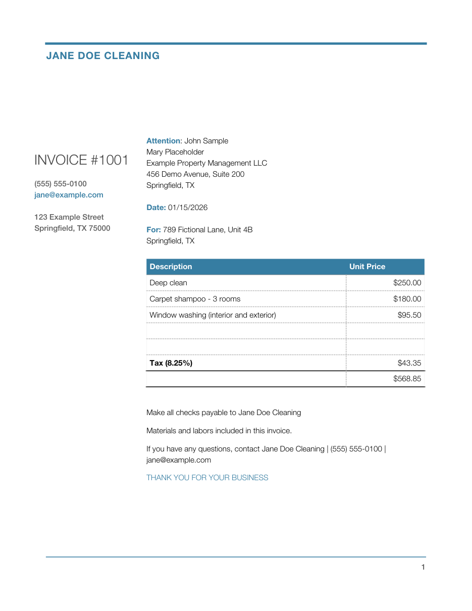

# invoicer

A free, local, terminal-based invoice generator. Built for people who send
nearly identical invoices over and over: pick a saved client, pick saved line
items, confirm, and get a PDF in under a minute.

No cloud, no accounts. Everything is stored in `~/.invoicer/data.json`.



## Install

Requires Python 3.9+.

```bash
git clone <this repo> invoicer && cd invoicer
python3 -m venv .venv
source .venv/bin/activate
pip install -r requirements.txt
```

## Usage

```bash
python invoice.py setup    # one time: your name, phone, email, address, tax rate
python invoice.py new      # create an invoice
python invoice.py repeat   # copy the last invoice with a new number and today's date
python invoice.py list     # view saved contacts, job addresses, items; delete entries
python invoice.py demo     # write docs/demo_invoice.pdf from fake data
```

### `new`

1. **Invoice number**: defaults to the last one + 1.
2. **Date**: defaults to today (MM/DD/YYYY).
3. **Bill to**: pick a saved contact with the arrow keys, or "+ Add new".
4. **For**: pick a saved job address, or "+ Add new".
5. **Line items**: start typing to search saved descriptions (Tab / arrow keys
   to pick); the last price you used is prefilled. Press Enter on a blank
   description to finish.
6. **Tax rate**: defaults to your saved rate.
7. Review the summary, then **Confirm**, **Edit a field**, or **Cancel**.

Confirmed invoices are saved to `invoices/Invoice_<number>_<YYYY-MM-DD>.pdf`.
Cancelling (or Ctrl-C) never uses up an invoice number.

### `repeat`

Jumps straight to the summary with everything from your last invoice, plus a
new number and today's date. Use **Edit a field** to change only what differs.

### Tips

- Saved lists show the most recently used entries first.
- New contacts and job addresses are saved as soon as you add them.
- In the "Bill to" list, choose "Edit a saved contact" or "Remove a saved contact"
  to fix or delete one without leaving the invoice.
- On macOS the PDF uses the system Helvetica Neue font (nothing is bundled);
  elsewhere it falls back to standard Helvetica.
- Set `INVOICER_HOME=/some/dir` to use a different data folder (useful for testing).
- Run the tests with `python -m unittest discover tests`.
- `python invoice.py demo` also writes `docs/demo_invoice.png` when
  `pymupdf` is installed (`pip install pymupdf`); it is not otherwise required.

## Weekly contractor invoices (from a work-log email)

Turns a weekly work-log email into the client's own `.xlsx` invoice template,
with an optional PDF.

```bash
python invoice.py from-email ~/Downloads/Invoice.eml
python invoice.py setup-weekly    # edit contractor info or replace the template
```

1. Save the email from your mail app as an `.eml` file (in Mail: File > Save As,
   format "Raw Message Source"; in Gmail: ⋮ > Download message).
2. The first run asks for the contractor info and the path to the blank `.xlsx`
   template, and keeps a private copy of it in `~/.invoicer/`.
3. Each job line such as `10/07- Client Name 123 Street $65` becomes a row
   (Client, Address, Date, Amount). Several jobs on one line are fine.
   Columns the email doesn't have are left blank.
4. Jobs with no amount are listed so you can enter one or leave it blank, and
   the total is checked against the email's `Total:` line.
5. The filled spreadsheet is saved to `invoices/Weekly_Invoice_<start>_to_<end>.xlsx`;
   answer yes to also save a one-page PDF next to it.

The template and emails contain real names and addresses, so `*.xlsx` and
`*.eml` are git-ignored.

## Money handling

All amounts use Python's `Decimal`. Tax is rounded to cents with
`ROUND_HALF_UP`, and amounts display as `$1,234.56`.

## License

MIT
